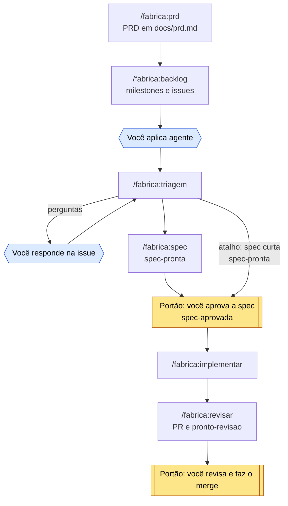

# Fluxo

Uma ideia vira produto em duas camadas:
- **Planejamento:** o PRD e o backlog, feitos uma vez e revistos quando o produto muda.
- **Ciclo de cada issue:** triagem, spec, implementação, revisão e merge, uma issue por vez.

Os retângulos são etapas de agente, que você dispara com o comando. Os hexágonos são ações suas que destravam o fluxo. Os retângulos duplos em amarelo são os **portões humanos**: nenhum agente passa deles sem você.

## Quem age em cada etapa
| Etapa | Quem age | O que sai |
|---|---|---|
| PRD | você e o agente, em entrevista | `docs/prd.md` com funcionalidades (F1, F2…) e fatiamento em marcos |
| Backlog | agente, com a sua confirmação | milestones `M<n> · <nome>` e issues enxutas do marco atual e do seguinte |
| Puxar | você | a label `agente` numa issue de backlog |
| Triagem | agente | comentário de triagem, com o campo `Interface`; perguntas na issue só para o que ela não sabe recomendar, e as recomendações seguem para a spec; no [atalho](#atalho), a spec curta e a label `spec-pronta` |
| Spec | agente | `specs/SPEC-<nº>.md` na branch da issue e a label `spec-pronta`; na primeira issue com interface, também o `docs/design.md` do projeto ([ADR 0009](adr/0009-aprovacao-visual-sem-ferramenta-de-design.md)) |
| **Aprovar a spec** | **você** | a label `spec-aprovada`, que também confirma as recomendações que a triagem levou para a spec |
| Implementação | agente | código e testes na branch, verificações registradas |
| Revisão | agente | revisão contra a spec, PR com evidências e a label `pronto-revisao` |
| **Merge** | **você** | squash na `main`; a issue fecha sozinha |

Você pode rodar cada etapa do agente pelo comando dela, ou deixar o [`/fabrica:avancar`](comandos.md#fabricaavancar-número-da-issue) executar as etapas em sequência. Ele para sozinho onde a tabela diz "você".

## Modelo por etapa
No Claude Code e no dispatcher, o `/fabrica:avancar` roda cada etapa no modelo que a [tabela da fábrica](../skills/avancar/modelos.md) dá para ela:

| Etapa | Modelo |
|---|---|
| Triagem | Sonnet |
| Spec | Opus, esforço médio |
| Implementação | o da label `modelo:haiku`, `modelo:sonnet` ou `modelo:opus` da issue (Sonnet sem label) |
| Revisão | Sonnet; Opus nas issues `modelo:opus` |

A triagem sugere a label pela complexidade da issue, e você pode trocá-la até aplicar `spec-aprovada`. A triagem fica fora do Opus porque é a primeira etapa a ler texto de issue, e o Opus segue instrução plantada em texto bem mais que o Sonnet. Se a implementação falha por qualidade, o `avancar` sobe o modelo da issue: Haiku passa para Sonnet na primeira falha e Sonnet passa para Opus na segunda. A decisão e as alternativas estão no [ADR 0013](adr/0013-modelo-por-etapa-e-por-issue.md).

No OpenCode, a etapa roda no modelo da sessão: a tabela não é usada, a triagem não aplica `modelo:*` e não há escalonamento. No Antigravity (`FABRICA_HARNESS=antigravity`), o `run_workflow` do `/fabrica:avancar` e a chamada ao `revisor` no `/fabrica:revisar` traduzem a tabela e as labels `modelo:*` para os tiers `flash_lite`, `flash` e `pro` via `scripts/stage-model.sh agy-tier`, mantendo a triagem sem aplicar `modelo:*` e sem escalonamento automático. A escolha é pela harness, não pela presença do binário `claude`, porque as ferramentas podem estar instaladas na mesma máquina.

Quando algo dá errado, o agente para, comenta na issue e aplica `escalonado`. Veja o guia [Issue escalonada](guias/issue-escalonada.md).

Quando a implementação ou a revisão dependem de uma ação sua fora do GitHub (criar uma conta, cadastrar um secret, gerar uma chave), o agente publica na issue uma checklist passo a passo e aplica `acao-externa`. Você faz os passos, marca os itens e retoma com `/fabrica:avancar`. Veja o guia [Ação externa](guias/acao-externa.md).

## Primeira ida para produção
Produção fica fora do alcance dos agentes ([ADR 0006](adr/0006-producao-fora-do-alcance-do-agente.md)). Quando você decidir lançar o projeto, rode [`/fabrica:lancamento`](comandos.md#fabricalancamento-número-da-issue-de-runbook): ele confere o que dá para conferir no repositório e em dev ou homologação e abre uma issue de runbook com a checklist dos passos que você faz em produção, partindo dos "Passos de produção" das specs. A etapa fica fora do ciclo das issues e do `/fabrica:avancar`, e vale só para o primeiro lançamento. Veja o guia [Lançamento](guias/lancamento.md).

## Atalho
Uma issue pequena e sem ambiguidade não precisa da etapa de spec. Quando a triagem vê que a issue é pequena, simples ou de documentação, sem perguntas e sem arquivos sensíveis, ela publica no próprio comentário uma **spec curta**, com o objetivo, os critérios de aceite, o que fica fora do escopo e o nome da branch, e aplica `spec-pronta`.

Os seus portões são os mesmos: você aprova a spec curta com `spec-aprovada`, e a issue segue para a implementação, a revisão e o merge como qualquer outra. Ela também conta para o limite de 3 em andamento.

Para tirar uma issue do atalho, comente na issue antes de aprovar. O próximo passo passa a ser o `/fabrica:spec`, que escreve a spec completa levando o seu comentário em conta. O critério está na [triagem](../skills/triagem/SKILL.md), e a decisão, no [ADR 0004](adr/0004-atalho-da-triagem-com-spec-curta.md).

## Uma worktree por issue
Cada issue com branch trabalha na própria worktree do git, em `<clone>/.worktrees/<nº>`. Assim, duas sessões, ou duas etapas do `/fabrica:avancar`, em issues diferentes do mesmo repositório nunca trocam a branch uma da outra, e o clone principal fica na branch em que você o deixou.
- **Quem cria:** a primeira etapa que precisa da branch (o `/fabrica:spec` ou, no atalho, o `/fabrica:implementar`). As seguintes reusam a mesma pasta.
- **Quem remove:** o merge é sempre seu, fora da fábrica. Por isso, o `/fabrica:spec`, o `/fabrica:implementar` e o `/fabrica:avancar` removem no começo as worktrees e as branches locais de PRs já fechados. Uma worktree com trabalho não enviado nunca é removida sozinha. O `/fabrica:status` aponta as que sobraram.
- **Limite:** no máximo 3 worktrees de issue por clone, contando as specs ainda não aprovadas.
- **Arquivos fora do git:** um `.env` e afins não vão para a worktree. Liste no `.worktreeinclude` do clone, no mesmo formato do Claude Code, os arquivos ignorados que a worktree nova deve receber.
- **Dependências:** a worktree nova não tem `node_modules` nem outras dependências instaladas; o `make` do projeto decide como instalá-las.

O script é o `scripts/issue-worktree.sh`, e a decisão está no [ADR 0014](adr/0014-uma-worktree-por-issue.md). As mensagens do script estão em [Solução de problemas](solucao-de-problemas.md#a-etapa-parou-no-issue-worktreesh-ensure).

## Onde está o estado
Não existe arquivo de estado. O estado de cada issue é lido do GitHub:
- as labels;
- os comentários dos agentes, que começam com um marcador como `<!-- fabrica:spec -->`, e a checklist do comentário de ação externa;
- o PR da branch da issue;
- nas issues de backlog, a milestone `M<n>` e o marcador `<!-- fabrica:backlog item=<n> -->` no corpo, que dão o avanço por marco.

A tabela completa de estados, com quem age e o próximo passo de cada um, fica em [`skills/status/estados.md`](../skills/status/estados.md). O `/fabrica:status` aplica essa tabela e mostra o quadro.

## Lições aprendidas
O que dá errado no caminho fica registrado na hora, num comentário de lição na issue, com a label `licao`:
- **Pelos agentes:** a triagem, a implementação e a revisão registram uma lição quando param para perguntar, escalam, precisam de várias rodadas de correção, desviam do desenho da spec ou deixam um achado sério sem corrigir.
- **Por você:** com [`/fabrica:licao`](comandos.md#fabricalicao-donoreponúmero-texto-da-lição), numa issue ou num PR.

A lição não muda o estado da issue. O `/fabrica:status` conta as lições desde o último marco fechado, e a busca pela label `licao` reúne todas. O [`/fabrica:retro`](comandos.md#fabricaretro-repositório) lê as lições ainda não consideradas, junto com os escalonamentos e os seus pedidos nos PRs, e propõe mudanças no fabrica. As lições que ele considera ganham a linha `Retro` e não voltam na próxima retrospectiva. O formato e os gatilhos estão em [`skills/licao/formato.md`](../skills/licao/formato.md).

## Planejamento em ondas
O backlog não cria todas as issues de uma vez:
- **Milestones:** todas existem desde o início.
- **Issues:** só o marco atual e o seguinte ganham issues.
- **Avanço:** quando o marco atual está perto de fechar, o `/fabrica:status` avisa para rodar o `/fabrica:backlog` de novo, e a janela avança.

Veja [Fechar um marco](guias/fechar-marco.md) e a seção "Backlog" de [`estados.md`](../skills/status/estados.md).
