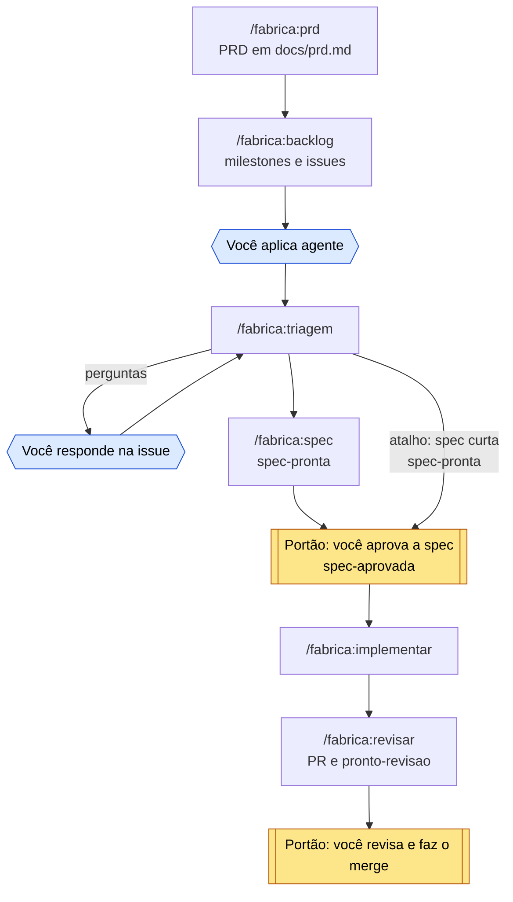

# Fluxo

Uma ideia vira produto em duas camadas:
- **Planejamento:** o PRD e o backlog, feitos uma vez e revistos quando o produto muda.
- **Ciclo de cada issue:** triagem, spec, implementação, revisão e merge, uma issue por vez.

Os retângulos são etapas de agente, que você dispara com o comando. Os hexágonos são ações suas que destravam o fluxo. Os retângulos duplos em amarelo são os **portões humanos**: nenhum agente passa deles sem você.

## Quem age em cada etapa
| Etapa | Quem age | O que sai |
|---|---|---|
| PRD | você e o agente, em entrevista | `docs/prd.md` com funcionalidades (F1, F2…) e fatiamento em marcos |
| Backlog | agente, com a sua confirmação | milestones `M<n> · <nome>` e issues enxutas do marco atual e do seguinte |
| Puxar | você | a label `agente` numa issue de backlog |
| Triagem | agente | comentário de triagem; perguntas na issue se faltar informação; no [atalho](#atalho), a spec curta e a label `spec-pronta` |
| Spec | agente | `specs/SPEC-<nº>.md` na branch da issue e a label `spec-pronta` |
| **Aprovar a spec** | **você** | a label `spec-aprovada` |
| Implementação | agente | código e testes na branch, verificações registradas |
| Revisão | agente | revisão contra a spec, PR com evidências e a label `pronto-revisao` |
| **Merge** | **você** | squash na `main`; a issue fecha sozinha |

Você pode rodar cada etapa do agente pelo comando dela, ou deixar o [`/fabrica:avancar`](comandos.md#fabricaavancar-número-da-issue) executar as etapas em sequência. Ele para sozinho onde a tabela diz "você".

Quando algo dá errado, o agente para, comenta na issue e aplica `escalonado`. Veja o guia [Issue escalonada](guias/issue-escalonada.md).

## Atalho
Uma issue pequena e sem ambiguidade não precisa da etapa de spec. Quando a triagem vê que a issue é pequena, simples ou de documentação, sem perguntas e sem arquivos sensíveis, ela publica no próprio comentário uma **spec curta**, com o objetivo, os critérios de aceite e o nome da branch, e aplica `spec-pronta`.

Os seus portões são os mesmos: você aprova a spec curta com `spec-aprovada`, e a issue segue para a implementação, a revisão e o merge como qualquer outra. Ela também conta para o limite de 3 em andamento.

Para tirar uma issue do atalho, comente na issue antes de aprovar. O próximo passo passa a ser o `/fabrica:spec`, que escreve a spec completa levando o seu comentário em conta. O critério está na [triagem](../skills/triagem/SKILL.md), e a decisão, no [ADR 0004](adr/0004-atalho-da-triagem-com-spec-curta.md).

## Onde está o estado
Não existe arquivo de estado. O estado de cada issue é lido de três lugares no GitHub:
- as labels;
- os comentários dos agentes, que começam com um marcador como `<!-- fabrica:spec -->`;
- o PR da branch da issue.

A tabela completa de estados, com quem age e o próximo passo de cada um, fica em [`skills/status/estados.md`](../skills/status/estados.md). O `/fabrica:status` aplica essa tabela e mostra o quadro.

## Lições aprendidas
O que dá errado no caminho fica registrado na hora, num comentário de lição na issue, com a label `licao`:
- **Pelos agentes:** a triagem, a implementação e a revisão registram uma lição quando param para perguntar, escalam, precisam de várias rodadas de correção, desviam do desenho da spec ou deixam um achado sério sem corrigir.
- **Por você:** com [`/fabrica:licao`](comandos.md#fabricalicao-donoreponúmero-texto-da-lição), numa issue ou num PR.

A lição não muda o estado da issue. O `/fabrica:status` conta as lições desde o último marco fechado, e a busca pela label `licao` reúne todas. O [`/fabrica:retro`](comandos.md#fabricaretro-repositório) lê as lições ainda não consideradas, junto com os escalonamentos e os seus pedidos nos PRs, e propõe mudanças no fabrica. As lições que ele considera ganham a linha `Retro` e não voltam na próxima retrospectiva. O formato e os gatilhos estão em [`skills/licao/formato.md`](../skills/licao/formato.md).

## Planejamento em ondas
O backlog não cria todas as issues de uma vez:
- **Milestones:** todas existem desde o início.
- **Issues:** só o marco atual e o seguinte ganham issues.
- **Avanço:** quando o marco atual está perto de fechar, o `/fabrica:status` avisa para rodar o `/fabrica:backlog` de novo, e a janela avança.

Veja [Fechar um marco](guias/fechar-marco.md) e a seção "Backlog" de [`estados.md`](../skills/status/estados.md).
